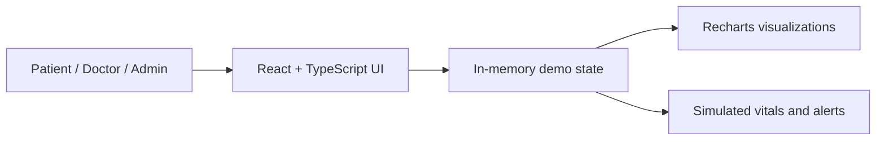
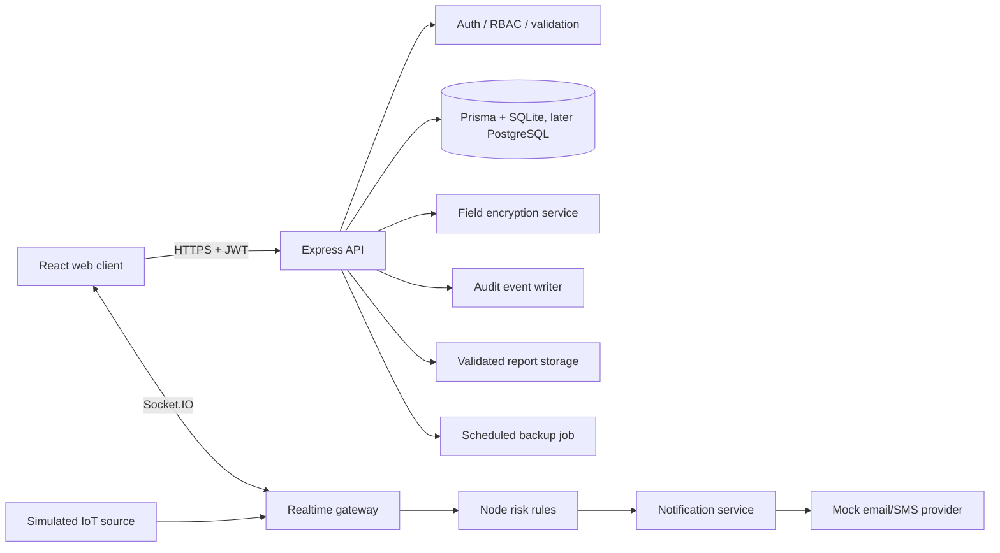
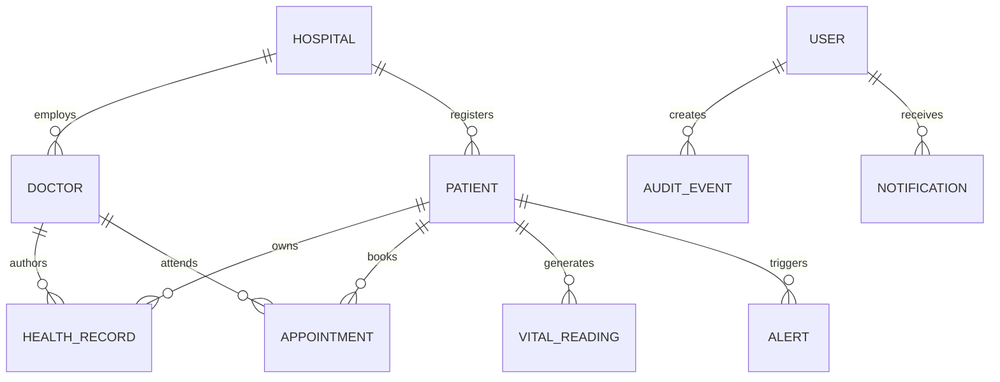
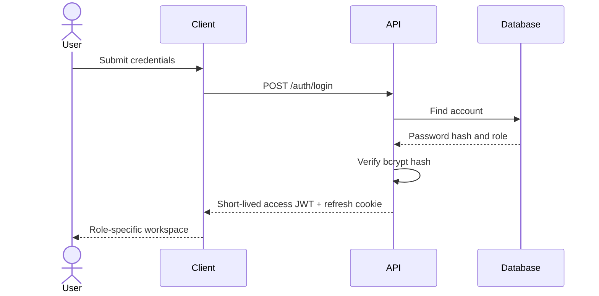
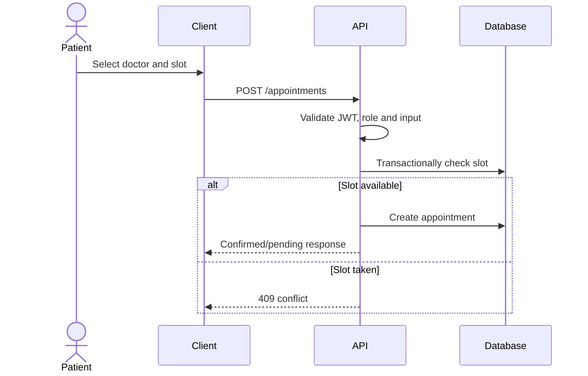
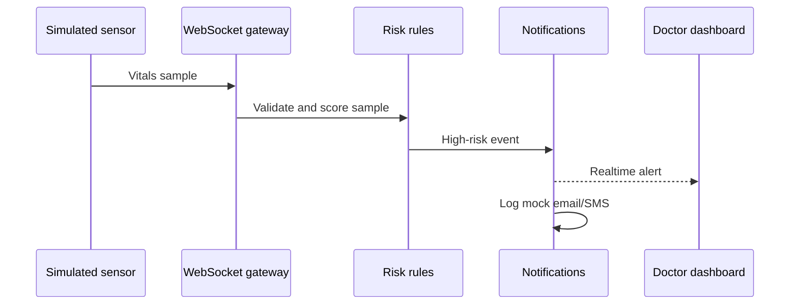

# Architecture

## Current ZIP architecture



The current artifact is frontend-only. There is no backend or database connection.

## Intended target architecture



## Component diagram

```mermaid
flowchart TB
  subgraph Client
    Router[React Router]
    Dash[Role dashboards]
    RecordUI[Records UI]
    ApptUI[Appointments UI]
    VitalsUI[Monitoring and charts]
    Insights[Risk insights]
  end
  subgraph Server (planned)
    Express[Express routes]
    Middleware[JWT, RBAC, Zod, rate limit]
    Services[Domain services]
    Prisma[Prisma ORM]
  end
  Router --> Dash
  Router --> RecordUI
  Router --> ApptUI
  Router --> VitalsUI
  Router --> Insights
  Express --> Middleware --> Services --> Prisma
```

## ER diagram (target)



## Sequence: login (target)



## Sequence: appointment booking (target)



## Sequence: emergency alert (target)


